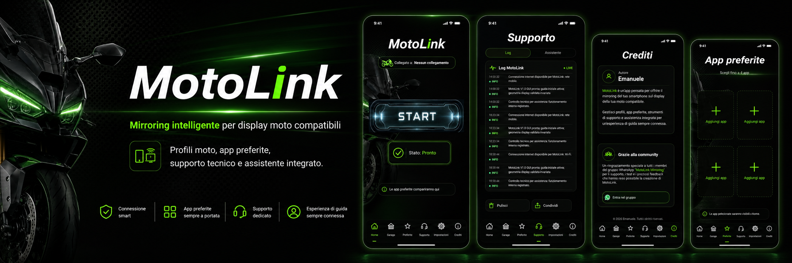
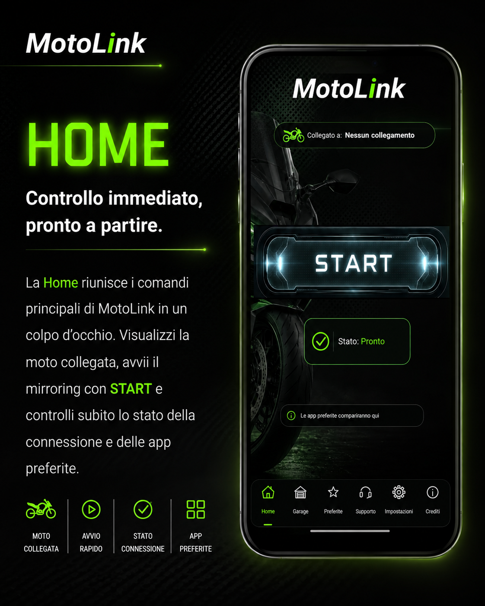
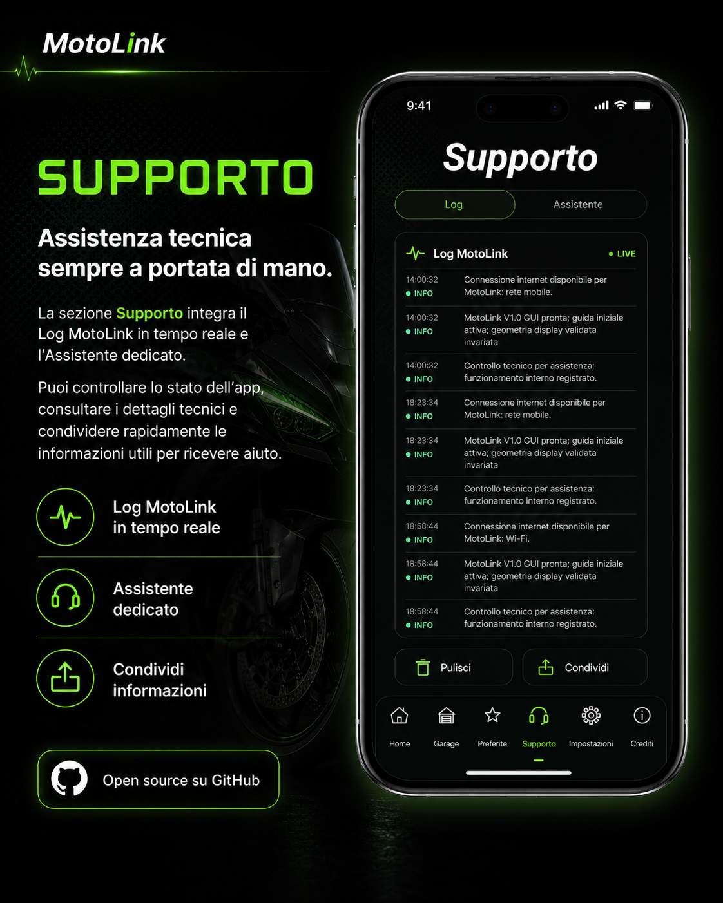
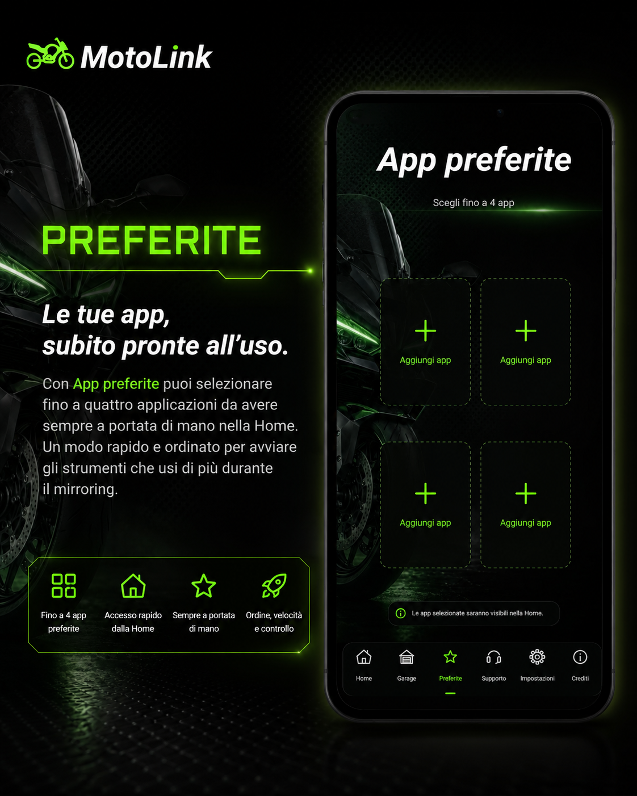
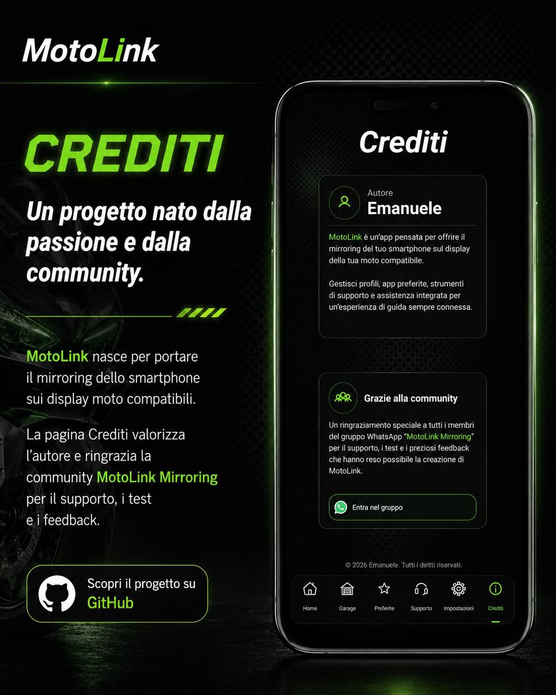

  

  
  &nbsp;
  

# MotoLink

**Porta il mirroring del tuo smartphone sul display della moto compatibile, con profili dedicati, app preferite, adattamento del display e strumenti di supporto integrati.**

MotoLink è un'app Android progettata per gestire in un unico ambiente il collegamento con il display della moto, il mirroring dello smartphone e le principali funzioni di configurazione e assistenza.

> [!IMPORTANT]
> Configura MotoLink, i profili, le applicazioni e le regolazioni **a veicolo fermo**. Non utilizzare lo smartphone o MotoLink in modo da compromettere l'attenzione durante la guida.

---

## 🆕 MotoLink V1.8.2 — traduzioni complete e BLE Resync

La V1.8.2 completa la traduzione automatica dell'interfaccia in **italiano, russo, cinese semplificato e inglese**. Segue la lingua del sistema Android; se la lingua non è supportata, usa **l'inglese**.

Sono stati corretti **Pronto**, **Nessun collegamento**, prefissi dello stato, nomi delle sezioni, descrizioni accessibili e messaggi del recupero Wi-Fi. Lo stato logico della moto resta indipendente dalla lingua visualizzata. È incluso il BLE Navigation Resync già testato positivamente nella V1.8.1.

**Aggiornamento ufficiale:** `it.motolink.app`, `versionCode 36`, `versionName 1.8.2`. Conserva la firma originale della V1.8/V1.8.1: **non disinstallare l'app precedente**, installa l'APK sopra per mantenere i dati.

**[Scarica direttamente MotoLink1.8.2.apk](https://github.com/Mysterx1992/MotoLink/releases/download/v1.8.2/MotoLink1.8.2.apk)** · [Note ufficiali V1.8.2](docs/RELEASE_NOTES_V1.8.2.md) · [Release GitHub](https://github.com/Mysterx1992/MotoLink/releases/tag/v1.8.2)

> Compilazione, controlli di localizzazione, firma e SHA-256 verificati. Rimane opportuno un collaudo visivo di tutte le schermate nelle quattro lingue.

---

## MotoLink V1.8.1 — aggiornamento precedente

La **V1.8.1** aggiunge il ripristino della navigazione **Google Maps sul TFT dopo la riconnessione Bluetooth BLE**. Il caso è stato segnalato da un tester che, lasciando la navigazione attiva e spegnendo il quadro per alcuni minuti, doveva premere STOP/START per far ricomparire le indicazioni.

### Cosa cambia nella V1.8.1

- **Riconnessione BLE:** quando il canale GATT torna pronto, MotoLink richiede una nuova lettura della notifica di navigazione Google Maps **attualmente attiva**, senza dover necessariamente attendere una svolta diversa.
- **Senza STOP/START:** l'app tenta il ripristino delle indicazioni senza riaprire Maps né interrompere la sessione di navigazione.
- **Protezione da dati vecchi:** vengono trasmesse solo istruzioni con manovra riconoscibile e distanza reale positiva; le notifiche obsolete, incomplete o non di navigazione vengono ignorate.
- **Nessuna regressione prevista sui collegamenti esistenti:** geometria EasyConn, Hotspot, QR, encoding dei pacchetti BLE e profili Garage non sono stati modificati.
- **Diagnostica aggiuntiva:** nel Log sono presenti i messaggi `BLE NAV RESYNC V1` e `MAPS NAV BLE RESYNC` per verificare l'effettivo ripristino.

**Identità APK V1.8.1:** `it.motolink.app` · `versionCode 35` · `versionName 1.8.1`. L'APK è stato compilato, firmato con il certificato ufficiale V1.8 e **pubblicato su GitHub Release v1.8.1**. Il collaudo fisico di riaccensione del TFT con questa correzione resta da completare.

> **Download diretto disponibile:** il pulsante verde **SCARICA MOTOLINK V1.8.1** scarica l'APK ufficiale, firmato con lo stesso certificato della V1.8. **Non disinstallare la V1.8:** installa la V1.8.1 sopra quella esistente per conservare profili e dati. SHA-256 dell'APK: `1d01d0886e13f44538d20c8cbbab9c86efe0cf722effa48dc9de6f64b5677b30`.

**Dettagli:** [Note tecniche V1.8.1](docs/RELEASE_NOTES_V1.8.1.md) · [Correzione ufficiale e verifiche su GitHub](https://github.com/Mysterx1992/MotoLink/releases/tag/v1.8.1).

---

## MotoLink V1.8 — funzioni delle versioni precedenti

La V1.8 introduce un **recupero Wi-Fi guidato per VOGE Trofeo 500** e rende più comode le Impostazioni e la guida iniziale, mantenendo le funzioni di mirroring e navigazione già presenti.

### Cosa cambia nella V1.8

- **Impostazioni → Ripristino Wi-Fi**: funzione manuale per i casi in cui la Trofeo 500 non si collega all'hotspot del telefono.
- Un solo pulsante **AVVIA** per la diagnostica Bluetooth Classic, SDP, BLE/GATT e scansione Wi-Fi, senza cambiare credenziali o inviare scritture GATT.
- **Permesso Dispositivi nelle vicinanze** richiesto al primo utilizzo, con prosecuzione automatica dopo il consenso.
- Finestre in stile nero/verde MotoLink con conferma, avanzamento ed esito della diagnostica.
- **Impostazioni scorrevoli**, con accesso alla voce Versione app e barra di navigazione fissa.
- **Guida iniziale** più leggibile, con schede più grandi posizionate senza coprire il controllo spiegato.
- **Versione app** ora mostra soltanto le novità della versione installata.

> **Limite di validazione:** sono stati verificati interfaccia e permessi sul telefono con la Lab2. Il recupero fisico Wi-Fi sul TFT della Trofeo 500 con questa integrazione non è ancora certificato: completare la procedura non garantisce il ripristino. Utilizzare a veicolo fermo.

## Scarica MotoLink

**[⬇️ SCARICA DIRETTAMENTE MOTOLINK V1.8.2 APK](https://github.com/Mysterx1992/MotoLink/releases/download/v1.8.2/MotoLink1.8.2.apk)**

[Consulta la release V1.8.2 e i file SHA-256](https://github.com/Mysterx1992/MotoLink/releases/tag/v1.8.2) · [Versione precedente V1.8](https://github.com/Mysterx1992/MotoLink/releases/tag/v1.8)

> Il file `MotoLink1.8.1.apk` è **già disponibile come asset pubblico GitHub**, versione 35, stesso package e firma della V1.8. La distribuzione è confermata da GitHub Actions con verifica byte-per-byte e SHA-256.

**Ultima release pubblicata qui:** MotoLink V1.8.2 · `versionCode 36` · `versionName 1.8.2`  
**Package:** `it.motolink.app`  
**Release:** https://github.com/Mysterx1992/MotoLink/releases/tag/v1.8.2  
**Novità:** [Note ufficiali V1.8.2](docs/RELEASE_NOTES_V1.8.2.md)

Le precedenti V1.8 e V1.7 restano disponibili nella sezione Release GitHub.

---

## MotoLink in azione

<table>
<tr>
<td width="50%" align="center"></td>
<td width="50%" align="center"></td>
</tr>
<tr>
<td width="50%" align="center"></td>
<td width="50%" align="center"></td>
</tr>
</table>

Gli screenshot originali dell'app sono disponibili in [`docs/screenshots`](docs/screenshots).

---

## Compatibilità moto

MotoLink è progettata per lavorare con display moto compatibili con i flussi supportati dall'app: mirroring EasyConn/Hotspot/QR e, sui modelli compatibili, navigazione BLE turn-by-turn.

La compatibilità reale può dipendere da modello della moto, display/T-Box, firmware, versione Android e implementazione EasyConn/Carbit/BLE presente sul display.

Moto sulle quali l'app è stata testata:

| Marca | Modello | Anno / versione | Display / sistema | Stato | Note |
|---|---|---|---|---|---|
| _Voge_ | _Trofeo_ | _2023_ | _TFT / EasyConn_ | ✅ Testata | _App implementata per questo specifico modello_ |
| _Voge_ | _Valico 900_ | _2026_ | _TFT / BLE / EasyConn dove disponibile_ | ✅ Testata | _Navigazione BLE fisicamente verificata; QR/EasyConn disponibile sulle configurazioni compatibili_ |
| _Voge_ | _Valico 625 DSX_ | _2025_ | _TFT / BLE_ | ✅ Testata | _Navigazione turn-by-turn BLE fisicamente verificata_ |
| _CFMOTO_ | _700 MT Stradale_ | _2024_ | _TFT / EasyConn_ | ✅ Testata | _Connessione P2P/EasyConn e avvio video verificati fisicamente nella lineage V1.5/V1.5.1_ |

> [!WARNING]
> Un display simile o appartenente allo stesso marchio **non garantisce automaticamente la compatibilità**. Modello e firmware devono essere verificati separatamente.

---

## Cosa fa MotoLink

### 🏍️ Connessione, mirroring e BLE

MotoLink gestisce il collegamento con il display moto compatibile. I profili Hotspot/QR vengono utilizzati per il mirroring EasyConn; il profilo BLE è dedicato alla navigazione turn-by-turn sui TFT VOGE compatibili.

### 🏠 Garage e profili moto

Il Garage permette di salvare e gestire fino a tre profili moto. Ogni profilo può mantenere le proprie impostazioni e regolazioni di Adattamento.

Al primo START, se non esiste ancora un profilo, MotoLink permette di scegliere **Hotspot, QR Code oppure BLE** e guida l'utente nella creazione del profilo prima di continuare la connessione.

### 🧭 Navigazione BLE

Con un profilo BLE compatibile MotoLink legge le indicazioni di navigazione esposte da Google Maps tramite il Notification Listener autorizzato dall'utente e le converte nel protocollo turn-by-turn del TFT. La modalità BLE non effettua mirroring video.

### ⭐ App preferite

Puoi selezionare fino a **quattro applicazioni preferite** e richiamarle rapidamente dalla Home.

### 📐 Adattamento display

MotoLink include strumenti per adattare manualmente l'immagine alla geometria del display della moto. Le regolazioni vengono mantenute per il relativo profilo moto e per orientamento.

### 📱 Modalità tasca

Durante il mirroring, se **Modalità tasca è attiva**, MotoLink può utilizzare il sensore di prossimità per oscurare lo schermo. Con **Modalità tasca disattivata**, resta preservata la protezione vc22. Con Modalità tasca attiva, resta congelato il fix vc27: il gate V1.5.1 arma la prossimità solo quando MediaProjection/video sono realmente pronti. Il comando con **doppio Volume Giù** resta disponibile separatamente per oscurare/riattivare lo schermo con blocco dei tocchi senza interrompere la sessione.

### 🛠️ Ripristino Wi-Fi Trofeo 500

Con **Impostazioni → Ripristino Wi-Fi** puoi avviare una diagnosi manuale per provare a recuperare il collegamento all'hotspot. Non è un comando di reset garantito e richiede una verifica sul TFT dopo il completamento.

### 🧰 Log MotoLink

La sezione **Supporto → Log** mostra al massimo le ultime **50 righe** per mantenere l'interfaccia leggera.

Il Log tecnico completo:

- resta locale sul dispositivo;
- non viene cancellato automaticamente;
- rimane disponibile fino al comando esplicito **Pulisci**;
- può essere condiviso dall'utente quando serve assistenza;
- viene conservato integralmente nel file `.txt`, anche quando la schermata mostra soltanto le righe più recenti.

### 🤖 Assistente MotoLink

L'Assistente è dedicato esclusivamente al supporto tecnico MotoLink. Una normale conversazione **non legge automaticamente il Log**.

Per allegare volontariamente la diagnostica:

**Supporto → Log → Condividi → Assistente**

MotoLink applica un filtro alle informazioni tecniche prima dell'elaborazione.

---

## Permessi e privacy

MotoLink è stata progettata per ridurre al minimo le autorizzazioni richieste e **non utilizza servizi di Accessibilità**.

La scansione QR può utilizzare Google Code Scanner oppure il fallback interno quando necessario.

Le funzioni tecniche possono richiedere:

| Accesso / conferma | Quando viene usato | Perché serve |
|---|---|---|
| **Connessione moto / Wi-Fi** | Collegamento Hotspot/QR | Comunicazione con il TFT tramite Wi-Fi / Wi-Fi Direct. |
| **Dispositivi Bluetooth vicini** | Profilo BLE o Ripristino Wi-Fi | Scansione BLE, diagnostica GATT e navigazione turn-by-turn sui TFT compatibili. |
| **Accesso alle notifiche** | Navigazione BLE con Google Maps | Lettura delle indicazioni di navigazione esposte dalla notifica di Google Maps. |
| **Fotocamera** | Solo quando serve il fallback scanner QR interno | Lettura del QR della moto. |
| **MediaProjection / condivisione schermo** | Avvio mirroring | Autorizzazione Android alla cattura dello schermo o di una singola app. |
| **Mostra sopra altre app** | Quando richiesto | Modalità tasca / schermo nero e pannello di Adattamento. |

Per maggiori informazioni consulta [`PRIVACY.md`](PRIVACY.md).

---

## Supporto e community

- **Assistente integrato:** Supporto → Assistente
- **Log tecnico:** Supporto → Log
- **Community MotoLink Mirroring:** [gruppo WhatsApp](https://chat.whatsapp.com/BNTmFxXQuOkGdYWHrX2rV0?s=cl&p=a&mlu=4)

La community contribuisce con test su moto e display differenti, feedback e supporto agli utenti.

---

## Stato del progetto

| Voce | Stato |
|---|---|
| Applicazione Android | ✅ Disponibile |
| Sorgente V1.8 | ✅ Pubblicata |
| APK ufficiale firmato | ✅ V1.8 |
| Mirroring EasyConn | ✅ Implementato |
| Navigazione BLE turn-by-turn | ✅ Implementata |
| Garage / profili moto | ✅ Implementato |
| App preferite | ✅ Implementato |
| Adattamento display | ✅ Implementato |
| Modalità tasca | ✅ Implementata |
| Log tecnico | ✅ Implementato |
| Assistente MotoLink | ✅ Implementato |
| Compatibilità moto | 🔄 In aggiornamento con i test reali |

---

## Codice sorgente

Il codice sorgente di MotoLink è **pubblico e consultabile** in questa repository per finalità di studio, trasparenza e verifica.

> [!IMPORTANT]
> **MotoLink non è distribuito con una licenza open source.** Il software è protetto da copyright e tutti i diritti sono riservati. La disponibilità pubblica del sorgente non autorizza automaticamente copia, modifica, ridistribuzione o creazione di opere derivate. Consulta [`LICENSE`](LICENSE) per i termini completi.

---

## Avvertenza durante la guida

MotoLink è uno strumento di mirroring e supporto. **Non deve essere utilizzata come unica fonte di informazioni critiche durante la guida.** Configura destinazioni, applicazioni, profili e regolazioni prima di partire.

---

## Progetto e marchi

MotoLink è un progetto indipendente. I nomi, i marchi, i loghi, i sistemi operativi e i servizi di terze parti eventualmente citati appartengono ai rispettivi proprietari.

---

## Licenza e copyright

**Copyright © 2026 Emanuele. Tutti i diritti riservati.**

Il codice sorgente di MotoLink è pubblicamente consultabile per finalità di studio, trasparenza e verifica. Non è concessa alcuna autorizzazione a copiare, modificare, distribuire, sublicenziare, vendere, ripubblicare o creare opere derivate dal software, in tutto o in parte, senza previa autorizzazione scritta del titolare del copyright.

Per i termini completi consulta [`LICENSE`](LICENSE).

---

  <strong>MotoLink V1.7</strong> 
  Mirroring • BLE Turn-by-Turn • Connessione • Supporto

